# 🤖 AI 求职机 (AI Job App)

> 一款面向高校学生的 AI 驱动的全栈智能求职平台。基于大语言模型（LLM），提供从简历解析、多维度 AI 诊断到求职匹配的全链路闭环体验。

## ✨ 核心功能亮点

- **📄 真实文件解析**：支持 PDF、Word、TXT 格式简历上传（≤10MB），后端利用 PDFBox / POI 真实提取文本内容。
- **🧠 AI 智能诊断**：结合 Dify 搭建大模型工作流，从“职位匹配、结构层次、视觉美观、真诚度、亮点呈现”五大维度对简历进行深度评分与建议。
- **🔄 异步状态机与轮询**：针对大模型长耗时痛点，后端采用 `@Async` 异步解耦，前端实现 2 秒轮询与 3 分钟超时兜底，流畅展示“分析中 -> 已生成”状态。
- **📊 数据可视化**：前端基于 uCharts 动态渲染五维雷达图与柱状图，直观展示 AI 诊断结果。
- **🔍 岗位检索与联动**：支持多条件筛选（学历/经验/薪资），对接真实 MySQL 数据库，实现动态模糊查询。

---

## 📸 界面展示 (UI Showcase)

### 1. 核心业务闭环 (已完成前后端联调)

**首页与导航**
> 平台主入口，提供简历诊断与求职列表两大核心功能。
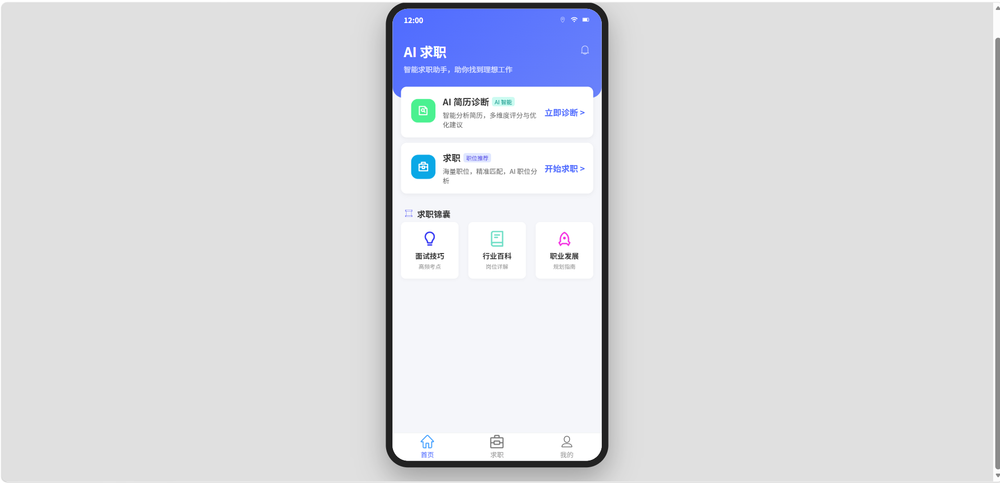

**上传简历与解析**
> 支持 PDF、Word、TXT 真实文件上传，后端自动提取纯文本并落库。
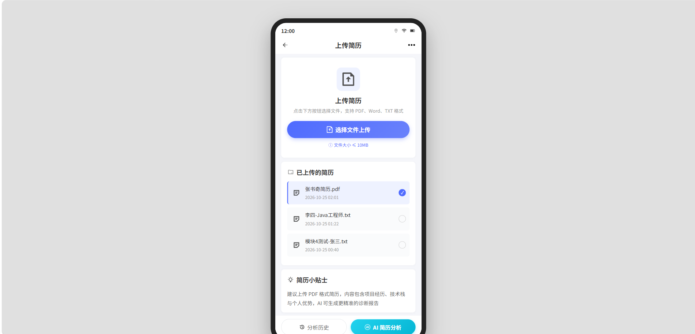

**AI 异步分析中**
> 前端实现 2 秒轮询机制，配合后端异步任务，展示真实的生成状态。
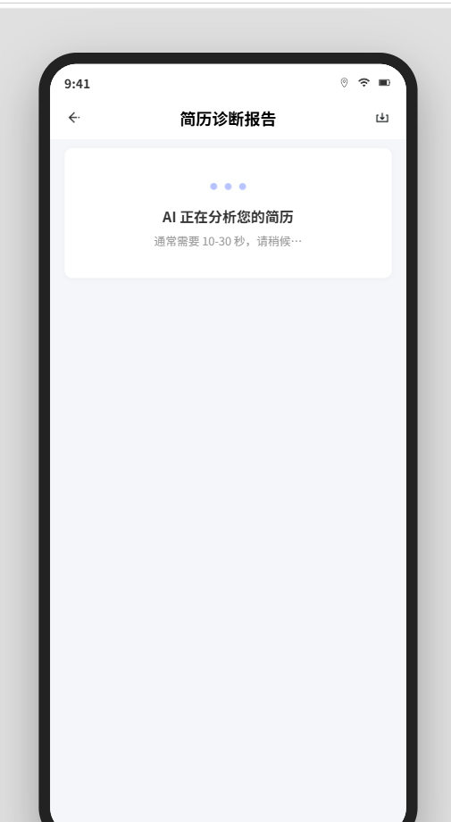

**历史记录 (真实数据)**
> 从 MySQL 数据库真实查询历次分析报告，支持点击回溯。
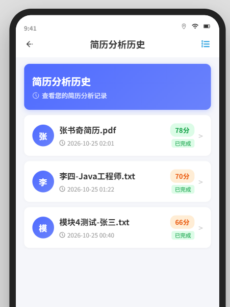

---

### 2. AI 简历诊断报告详情 (长图截取)

**总分与评价**
> 展示大模型评估的最终得分、环形图与综合评价。
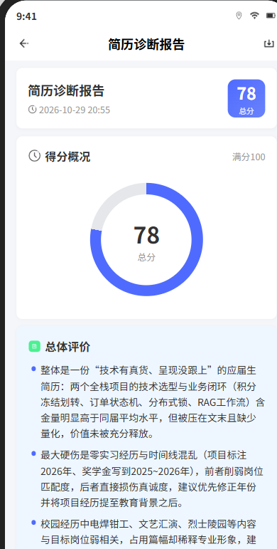

**职位匹配度**
> 基于专业技能、经验等维度的柱状图展示与 AI 建议。
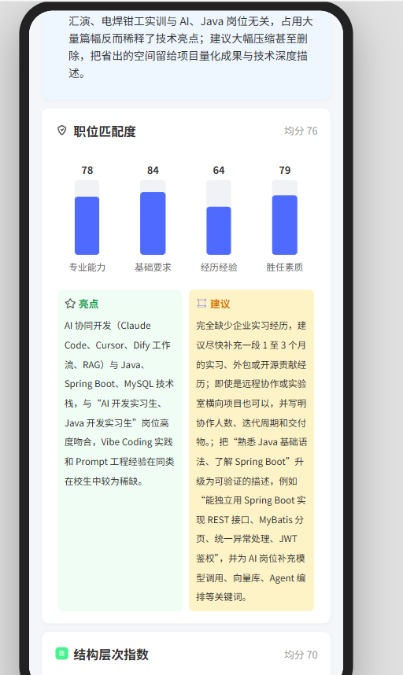

**结构层次指数**
> 评估简历的排版逻辑与模块完整性。
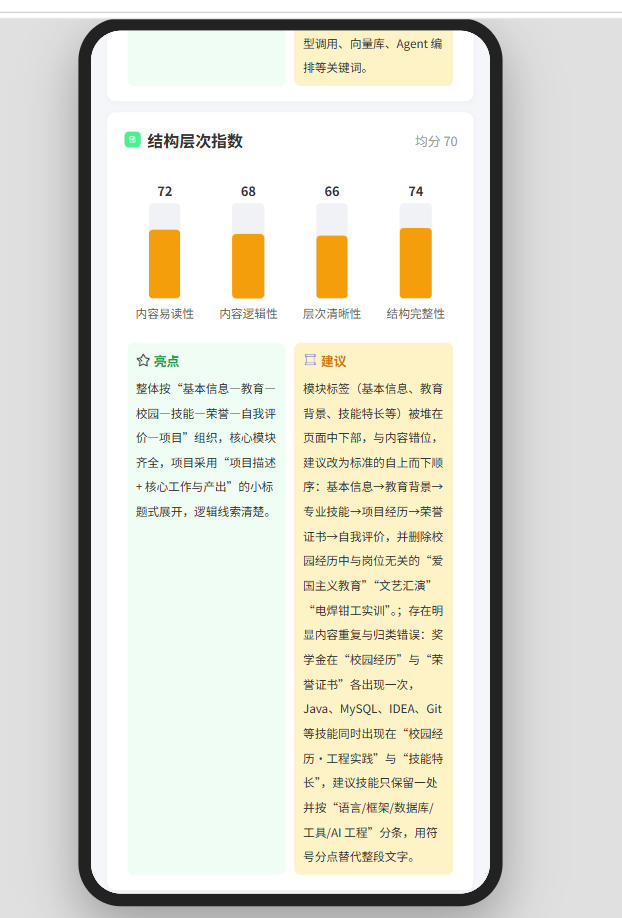

**视觉美观指数**
> 评估简历的视觉设计与颜色搭配。
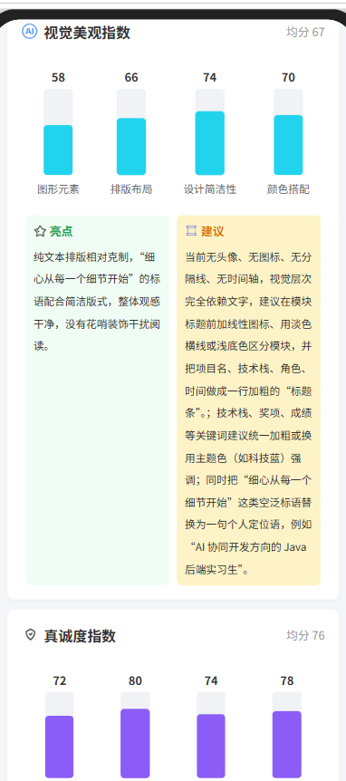

**亮点呈现指数**
> 评估简历中优势展示、关键词使用及量化数据的呈现效果。
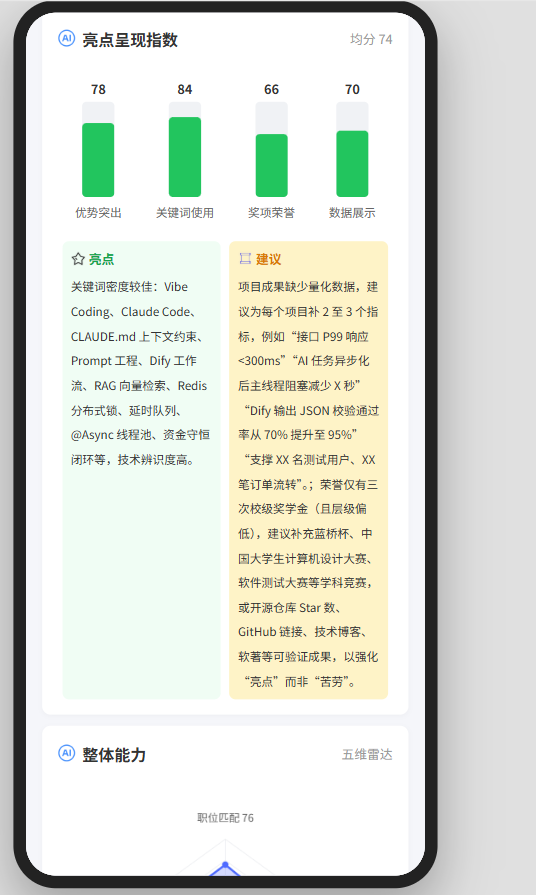

**五维雷达图 (整体能力)**
> 综合呈现候选人的各项能力维度。
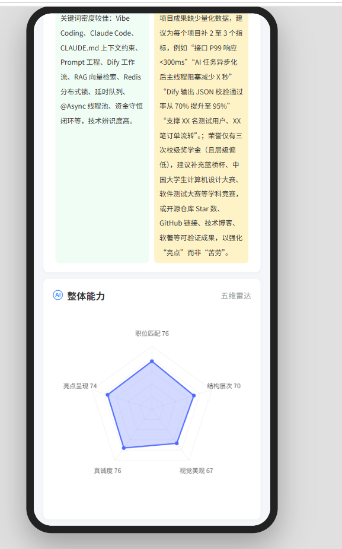

---

### 3. 求职与筛选模块

**求职列表**
> 展示海量职位卡片，包含薪资、公司、技术标签等核心信息。
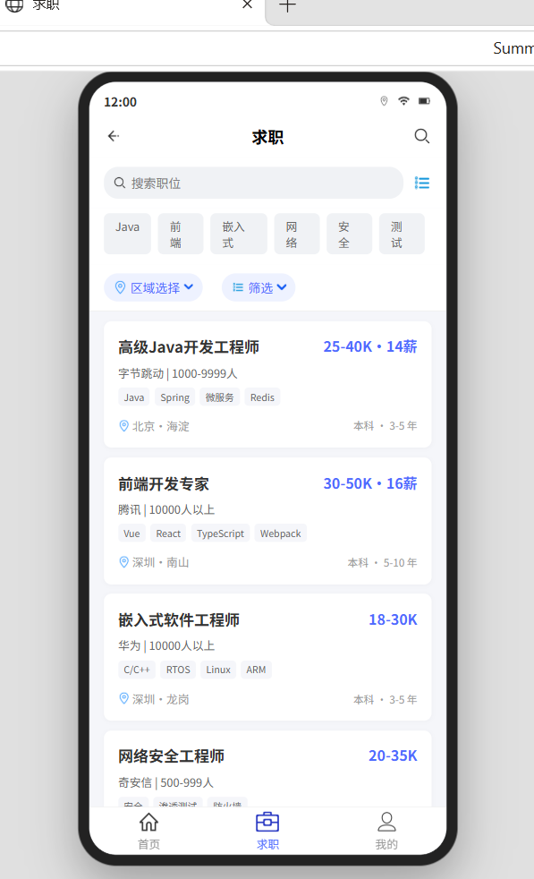

**岗位搜索 (关键字)**
> 支持按技术栈（如 Java）进行模糊检索，后端动态拼接 SQL。
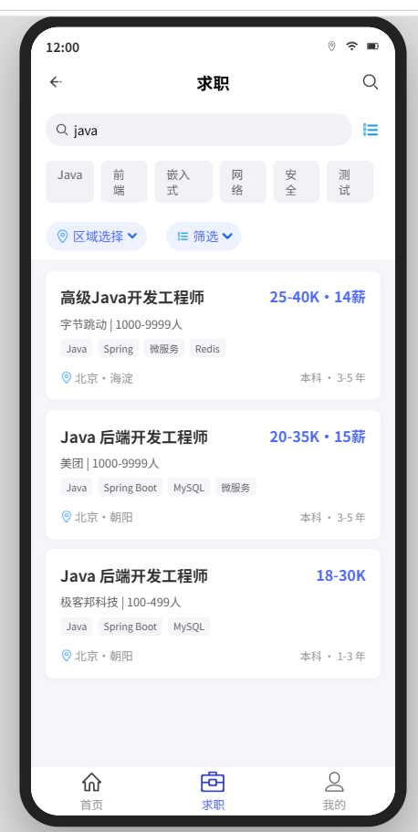

**岗位多条件筛选**
> 左侧分类导航与右侧选项联动，支持学历、经验、薪资等多维度过滤。
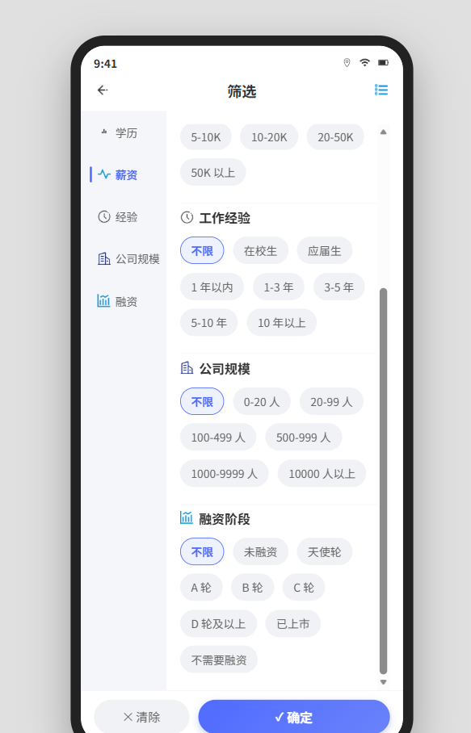

**职位详情页**
> 展示完整的 JD 信息、技能标签及 AI 模拟面试入口。


---

### 4. 个人中心与扩展模块 (UI 静态高保真还原)

**我的页面**
> 个人中心主页，展示用户基本信息及快捷入口。
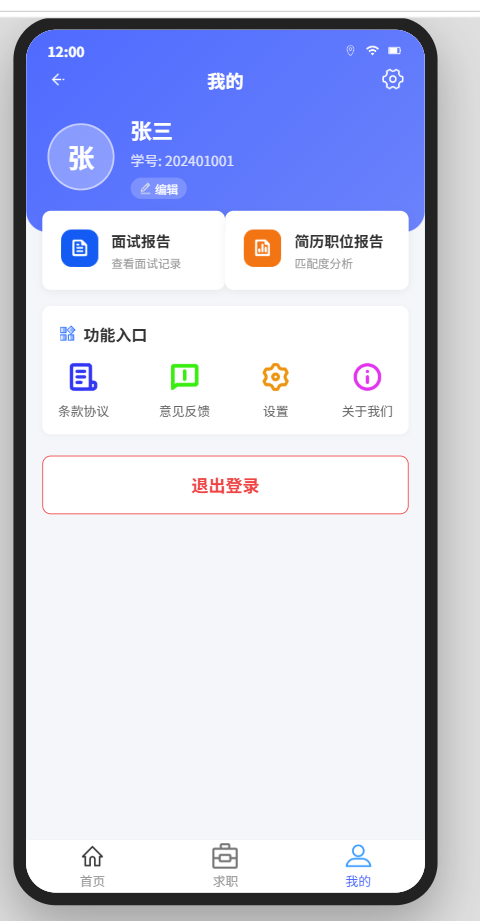

**个人信息编辑**
> 支持修改头像、基础信息及保存。
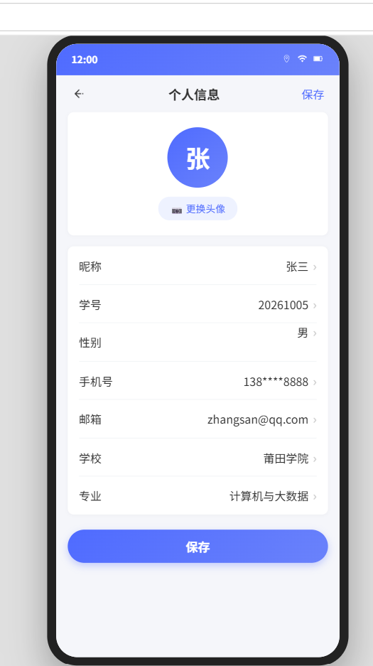

**职位简历报告列表**
> 展示用户所有投递职位的简历匹配报告。


**AI 模拟面试 (深色主题)**
> 沉浸式深色主题，支持摄像头预览与语音答题状态管理。


**面试列表**
> 历史面试记录与状态统计。


**面试报告**
> 逐题展示大模型针对面试回答给出的优化建议。


---

## 🏗️ 系统架构与数据流

```text
[前端 UniApp (Vue3 + Vite)]
       │ 
       │ 1. 上传简历 / 发起分析 (RESTful API)
       ▼
[后端 Spring Boot 3 (Java 17)]
       │ 
       ├── 2. (MyBatis-Plus) ──► [MySQL 数据库] (落库 status=0 生成中)
       │
       └── 3. (WebClient + @Async) ──► [Dify AI 工作流] (大模型推理)
              │
              ├── 4. 正则清洗与 JSON 兜底解析
              │
       [前端 5. 每 2 秒轮询状态]
              │
       [后端 6. 更新数据库 status=1，返回结果]
              │
       [前端 7. uCharts 渲染雷达图/柱状图]
